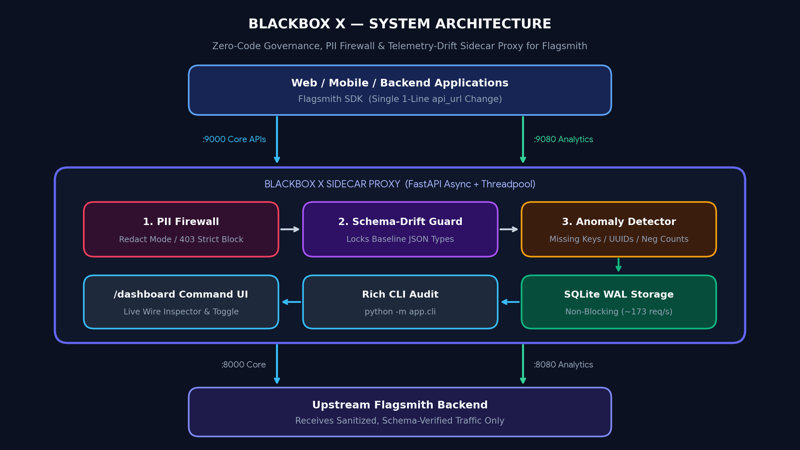

# BlackBox X

**High-Concurrency Governance, PII Firewall & Telemetry-Drift Sidecar Proxy for Flagsmith**

BlackBox X is a zero-code, drop-in reverse proxy and governance layer for [Flagsmith](https://github.com/Flagsmith/flagsmith). Sitting transparently between your application SDKs and Flagsmith's Core (`:8000`) and Analytics (`:8080`) backends, it intercepts wire traffic in real time to mask sensitive PII, quarantine non-compliant payloads at the edge, catch broken experiment telemetry, and lock remote-config schemas against unexpected type drift.

---

## System Architecture



---

## Key Capabilities

* **Dual-Port Transparent Proxying (`:9000` Core & `:9080` Analytics):** Routes flag evaluations (`:9000`) and high-volume analytics/telemetry (`:9080`) independently with full `Content-Encoding` preservation and zero SDK logic changes.
* **Mirrored PII Scrubber & Live Edge Quarantine (`REDACT MODE` / `403 STRICT BLOCK`):** Recursively redacts sensitive keys (`email`, `phone`, `ip`, `ssn`, `tokens`, query parameters) with `[redacted]` before payloads reach Flagsmith--or flips instantaneously into `403 STRICT BLOCK` mode to quarantine leaking requests at the edge.
* **Remote Config Schema-Drift Detection:** Learns baseline JSON value types (`str`, `int`, `float`, `bool`, `dict`, `list`) per feature key and flags runtime type mutations (e.g., `button_color` mutating from `str` to `dict/`int`) before malformed configs crash client apps.
* **Broken Experiment & Telemetry Anomaly Guard:** Detects missing environment keys (`MISSING_ENV_KEY`), ephemeral/malformed UUID identities, and corrupted negative analytics counts (`count < 0`).
* **Non-Blocking SQLite WAL Concurrency:** Engineered with SQLite Write-Ahead Logging (`WAL`) mode and async threadpool execution--verified under a 250-request cold-start chaos burst (~173 req/s) with zero database lock contention.
* **Embedded Command-Center UI (`/dashboard`) & Rich CLI (`app/cli.py`):** Includes a single-file real-time web dashboard with port filtering, live Wire Payload Inspector, and firewall toggle, paired with a terminal audit CLI.

---

## 3-Step Quickstart (Judge & Evaluator Guide)

### 1. Start the Unified Stack
```bash
git clone https://github.com/Madhava005/blackbox-x.git
Cd blackbox-x
docker compose up -d --build
```
* **BlackBox X Core Proxy & Dashboard:** `http://localhost:9000` (`http://localhost:9000/dashboard`)
* **BlackBox X Analytics Proxy:** `http://localhost:9080`
* **Upstream Flagsmith Core / UI:** `http://localhost:8000`

### 2. Run the 4-Stage Traffic & Drift Simulator
```bash
python -m app.simulate
```
* **Stage 1:** Healthy baseline checkout flag evaluations & analytics.
* **Stage 2:** Nested user trait & query-string PII leaks (`email`, `phone`, `ip`).
* **Stage 3:** Broken experiment telemetry (missing env keys, ephemeral UUIDs, negative counts).
* **Stage 4:** Remote config type mutation (`str -> dict/int`) triggering schema-drift alerts.

### 3. Audit via Rich CLI or Live Dashboard
```bash
python -m app.cli
```
Open **`http://localhost:9000/dashboard`** to filter streams by port (`:9000` vs `:9080`in Dashboard), inspect sanitized payloads in the **Wire Payload Inspector**, or toggle **PII FIRERALL** between `REDACT MODE` and `403 STRICT BLOCK`.

---

## Drop-In Integration for Existing Flagsmith Apps (1-Line Change)

```python
from flagsmith import Flagsmith

flagsmith = Flagsmith(
    environment_key="YOUR_CLIENT_SIDE_ENV_KEY",
    api_url="http://localhost:9000/api/v1/",  # Point SDK to BlackBox X
)
```

---

## Verification & Automated Test Suite

```bash
docker compose exec blackbox-x pytest -v
```
* (8/8 tests passing)

---

## Upstream Flagsmith Contribution

* **Upstream PR:** [Link to Flagsmith PR -- updating upon submission]

---

## Project Structure

```text
blackbox-x/
!-- app/
     -- main.py          # Dual-port FastAPI proxy (:9000/:9080) & embedded /dashboard UI
     -- scrubber.py      # Recursive trait & query-string PII redactor + 403 strict mode
     -- detector.py      # Schema-drift baseline tracker & experiment anomaly engine
     -- db.py            # Thread-safe SQDite WAL-mode persistence layer
     -- simulate.py      # 4-stage production traffic & schema-drift simulator
     -- cli.py           # Rich terminal audit report generator
!-- infra/               # Infrastructure & upstream Flagsmith stack configs
!-- tests/               # Pytest unit & simulator verification suite (8/8 passing)
!-- docker-compose.yml   # Unified Flagsmith + BlackBox X orchestration
!-- Dockerfile           # Lightweight Python 3.10 runtime container
!-- pytest.ini           # Pytest configuration
!-- README(A.md
```
